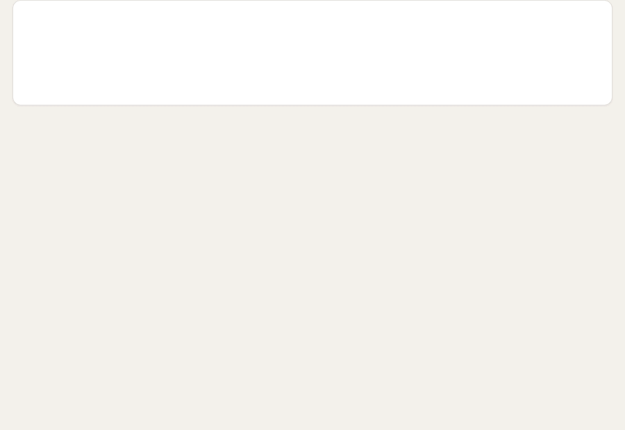
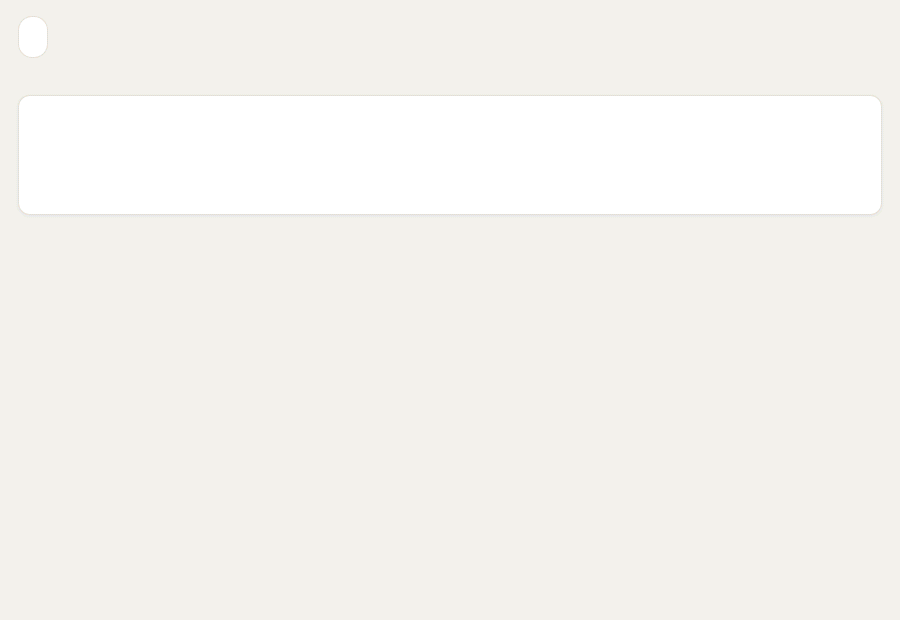
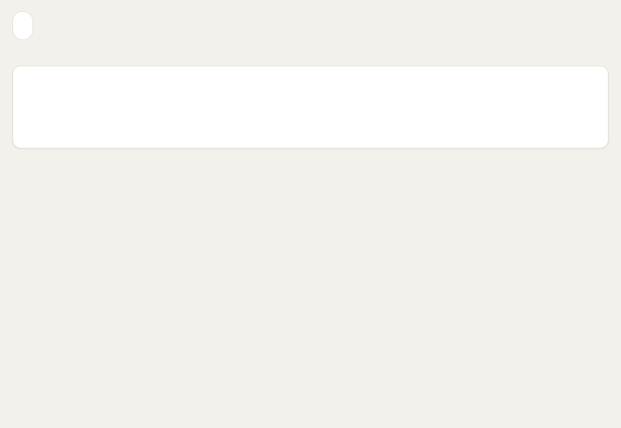
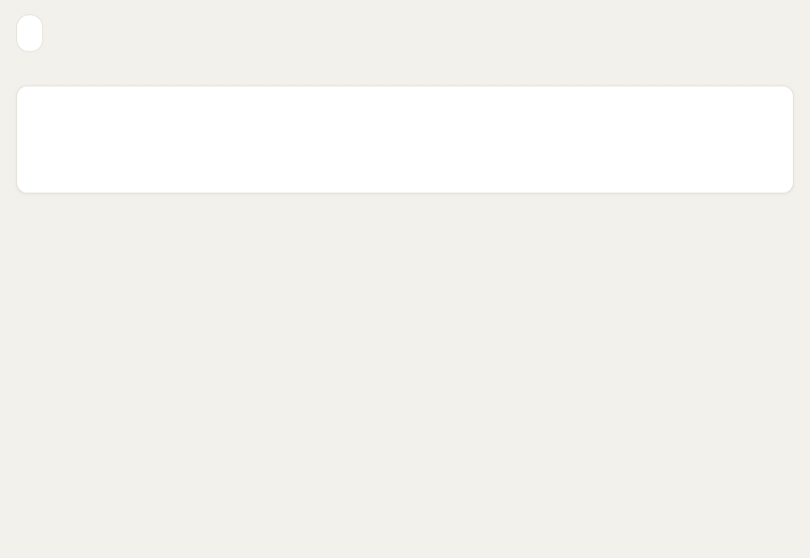
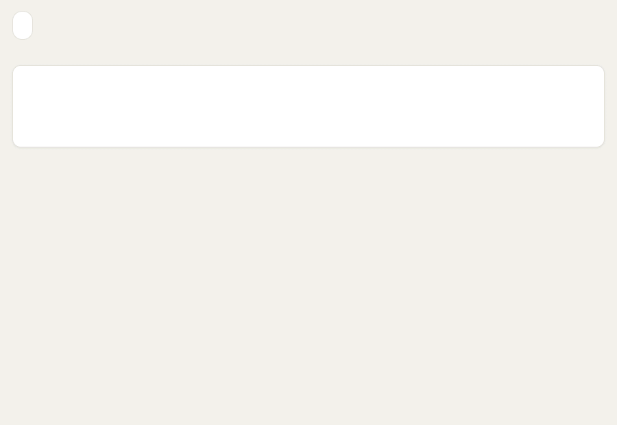
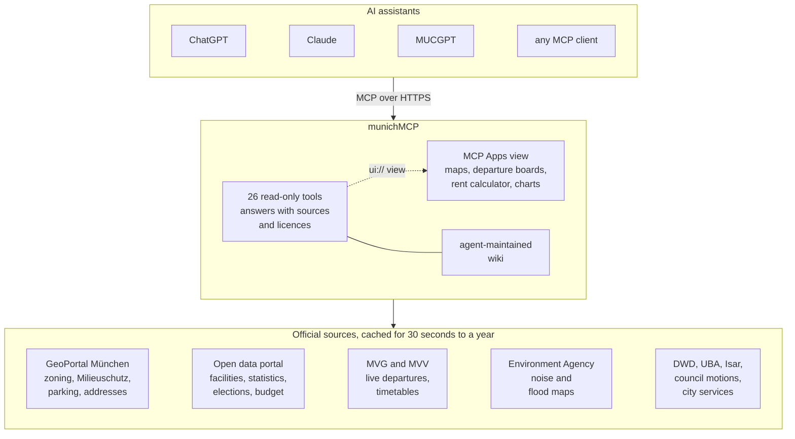
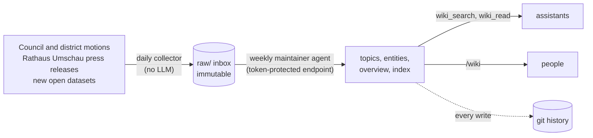

# munichMCP

**Ask an AI assistant about Munich and get official, cited answers.** What applies at an address, how loud the street is, whether it can flood, when the next U-Bahn leaves, what the fair rent is, how the neighbourhood voted, where the city's money goes. munichMCP is a [Model Context Protocol](https://modelcontextprotocol.io) server over Munich's public data, with interactive views ([MCP Apps](https://github.com/modelcontextprotocol/ext-apps)) that render inside ChatGPT and Claude.

It is an **unofficial** proposal for an official city MCP and is not affiliated with the Landeshauptstadt München.

<p align="center">
  
</p>

- Live server: `https://munichmcp.duckdns.org/mcp` (Streamable HTTP, no auth, read-only)
- Browser playground: `https://munichmcp.duckdns.org/playground`
- Wiki: `https://munichmcp.duckdns.org/wiki`

## See it in action

<table>
  <tr>
    <td width="50%" valign="top"><br><b>Noise and flood risk.</b> Official EU noise maps and flood hazard maps for any address, as switchable map layers.</td>
    <td width="50%" valign="top"><br><b>Getting around.</b> Live departures with replacement services and cancellations, and door-to-door trips with fare zones.</td>
  </tr>
  <tr>
    <td width="50%" valign="top"><br><b>Rent check.</b> The official Mietspiegel 2025 comparative rent, recalculated inside the chat as you change the flat's details.</td>
    <td width="50%" valign="top"><br><b>Civic data.</b> Election results by district, the city budget by department, and when your district's residents' assembly meets.</td>
  </tr>
</table>

The recordings show live data from the public server in the playground, which renders the same MCP Apps view as ChatGPT and Claude. `npm run demos` re-records them.

## How it works



1. You ask your assistant a question about Munich. It picks a tool, for example `noise_and_flood` with your address.
2. munichMCP geocodes the address with the city's own address index and queries the official sources, mostly from a cache so the city's servers see little load.
3. The answer comes back as text with its sources, licences and retrieval times, plus a structured result. Hosts that support MCP Apps render the interactive view next to the answer.

## What it can answer that web search cannot

| Tool | What it does | Main sources |
|---|---|---|
| `address_report` | Everything that applies at an address: district, zoning plans (with PDFs), Milieuschutz, resident-parking area, low-emission zone, chimney-sweep district, rooftop solar, noise, flood risk, local election result, roadworks, e-scooter rules, nearest stops and facilities | GeoPortal WFS/WMS, city address index, LfU, Wahlamt |
| `noise_and_flood` | Road, tram/U-Bahn and industrial noise (Lden and Lnight in dB(A), EU noise maps 2022) and river flood hazard (frequent, 100-year, extreme, designated zones), with the official maps as switchable map layers | Bavarian Environment Agency (LfU), CC BY 4.0 |
| `election_results` | City council and mayoral election 2026, federal election 2025: city, district, polling precinct (from an address) and constituency, or one party across all districts | Wahlamt, dl-de/by-2.0 |
| `city_budget` | Income and expenses of about 200 city services, per department and year since 2018, with cost per resident | Stadtkämmerei, Statistisches Amt |
| `citizens_assemblies` | Dates and venues of the district residents' assemblies (Bürgerversammlungen), from an address or district | Direktorium, open data |
| `find_address` | Geocoding with the city's official address index (162k addresses) | GeoPortal search, Photon fallback |
| `find_nearby` | 30 categories of official facilities (drinking fountains, toilets, playgrounds, Kitas, libraries, pools, public Wi-Fi, P+R, EV charging, recycling, live MyRadl bikes, ...) | open data portal, GBFS |
| `roadworks_near` | Construction sites and temporary no-parking zones for the next 4 weeks | Mobilitätsreferat |
| `mobility_rules_at` | E-scooter no-riding / no-parking zones, 100 m geofences, designated sharing areas | Mobilitätsreferat |
| `damage_reports_near` | Citizen reports (street lights, potholes, ...) near an address | machmuenchenbesser.de Open311 (CC0) |
| `departures`, `nearby_stops`, `plan_trip`, `transit_disruptions` | Live departures, journey planning, disruptions | MVG (unofficial, cached), MVV GTFS |
| `search_city_services`, `get_city_service` | 1,450 official service articles and 465 online services | it@M Hugging Face corpus, online services list |
| `estimate_rent` | Mietspiegel 2025 comparative rent, verified against the official calculator | Mietspiegel für München 2025 |
| `council_search` | City council and district committee motions | RIS RSS (+ archive) |
| `isar_conditions` | Isar level, discharge, water temperature, flood class, bathing zones, danger spots | HND/GKD, LHP, city |
| `weather_air_pollen` | DWD weather and warnings, UBA air quality, DWD pollen | Bright Sky, UBA, DWD |
| `find_statistics`, `district_stats` | ~100 official statistics datasets by district and month | Statistisches Amt |
| `wiki_search`, `wiki_read`, `wiki_index` | Agent-maintained, cross-linked knowledge base | see below |
| `about_munichmcp` | Sources, licences, caveats | |

Every result names its sources with licence and retrieval time. See `wiki/sources/open-data-landschaft.md` for the full licence analysis, including what is deliberately **not** used.

**Questions to try:** [docs/demo-questions.md](docs/demo-questions.md) lists what flat hunters, newcomers, commuters, journalists and city staff ask, and which tools answer it.

### What the city could open next

Some of the most useful data is published but not under an open licence, so munichMCP does not use it: primary school catchment areas (Grundschulsprengel) and the zoning-plan layer with PDF links both require a separate agreement with the city; the results of the 2026 mayoral runoff are online but not on the open data portal; live departures come from MVG's unofficial (tolerated) API rather than an official open feed. Opening these would make the official version much better.

## The wiki (agent-maintained knowledge base)

A Karpathy-style "LLM wiki": instead of retrieving raw chunks at question time, maintainer agents compile primary sources into cross-linked Markdown pages ahead of time.



```
raw/      immutable captures, written daily by a deterministic collector (no LLM):
          council + district committee motions, Rathaus Umschau press releases, new open datasets
topics/ entities/ sources/ queries/ overview.md index.md log.md   compiled pages
schema.md                                                         the rules maintainers follow
```

- Public tools read and search it; `/wiki` renders it for humans.
- A token-protected **maintainer endpoint** (`/maintainer/mcp`) exposes write tools: `wiki_inbox`, `wiki_read_raw`, `wiki_write_page`, `wiki_mark_raw`, `wiki_archive_page`, `wiki_rebuild_index`, `wiki_lint`, `wiki_log`, `wiki_collect_now`.
- Every write is committed to a git repository inside the live wiki folder (audit trail, easy rollback).
- The repo's `wiki/` is the seed: new seed pages are copied into the live wiki on boot, existing pages are never overwritten.
- `scripts/generate-district-pages.ts` regenerates the 25 district pages from open data.

Refresh loop: the collector runs every `COLLECTOR_INTERVAL_HOURS` (default 24). Point any agent at the maintainer endpoint with `wiki/MAINTAINER_PROMPT.md` weekly, for example a Claude Code routine or the GitHub Action in `.github/workflows/wiki-maintainer.yml` (it stays inactive until the repository secrets `ANTHROPIC_API_KEY` and `MUNICHMCP_MAINTAINER_TOKEN` are set). The last full maintainer pass was on 2 October 2026.

## Connect

- **ChatGPT**: Settings, Apps & Connectors, Advanced settings, enable developer mode, then create a connector with the MCP URL.
- **Claude**: Settings, Connectors, Add custom connector, paste the MCP URL.
- **Claude Code**: `claude mcp add --transport http munichmcp https://munichmcp.duckdns.org/mcp`

## Develop

```bash
npm install
npm run build:ui          # single-file MCP Apps view + playground into dist/ui
npm run start:dev         # tsx src/server.ts on :8420
npm run typecheck         # server and UI
npm test                  # unit tests incl. 780 official Mietspiegel values
npm run smoke             # end-to-end over MCP against localhost (or pass a URL)
npm run demos             # re-record the README GIFs (needs Chrome or Edge and ffmpeg)
```

Environment: `PORT`, `PUBLIC_URL`, `DATA_DIR`, `WIKI_MAINTAINER_TOKEN`, `COLLECTOR_INTERVAL_HOURS`, `MIETSPIEGEL_ENABLED` (set `0` to disable the rent tool), `ALLOWED_HOSTS`.

## Deploy

`deploy/deploy.sh root@host` packs the tree, builds the Docker image on the host and restarts the container (bound to 127.0.0.1:8420). `deploy/nginx-munichmcp.conf` is the reverse proxy (TLS via certbot). Data (caches, live wiki with its git history) lives in `/opt/munichmcp/data`.

## Architecture

- TypeScript, MCP TypeScript SDK v2 (`createMcpHandler`: serves the 2026-07-28 protocol and stateless 2025 clients), Express.
- One MCP Apps view (`ui://munichmcp/view-v1.html`, Leaflet + basemap.de tiles) renders maps, departure boards, the rent calculator, bar charts and wiki pages; the noise and flood view adds the LfU's official WMS maps as switchable layers. The view's CSP allows only basemap.de and lfu.bayern.de. View-only payloads travel in `_meta` so they stay out of the model context.
- Open datasets are cached on disk and in memory (daily, roadworks hourly; final election results for a year; noise and flood lookups per address for 30 days); live APIs are cached for 30 s to 15 min to keep upstream load low; per-client rate limiting.

## Licence and data

Code: MIT. Data: each source keeps its licence (mostly dl-de/by-2.0, CC BY 4.0, CC0, MIT); see `about_munichmcp`. The Mietspiegel method is published by the city with all rights reserved; the rent tool can be switched off with `MIETSPIEGEL_ENABLED=0`.
